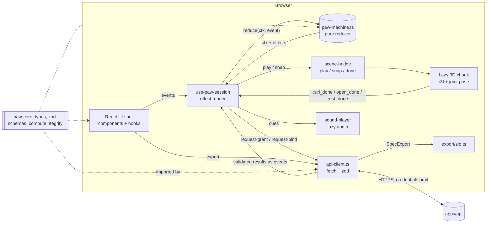

# Paw Web — Design

## Overview

`apps/web` is a Vite + React 19 + TypeScript (strict) single-page app. It renders one parchment plate with the 3D
paw at the centre, five curse circles around it and the wish line underneath. It calls `apps/api` over fetch and
imports pure logic, types and zod schemas from `paw-core`. It never imports from `apps/api` (structure.md).

Three design choices shape everything else:

1. **A pure state machine owns the story.** One reducer (`paw-machine.ts`) holds the phase, the curled-digit stack,
   the closed-curse set, the animation queue and the reduced-motion flag. It has no React, three or DOM imports.
   Every rule of Req 5 and Req 6.6–6.10 lives there and is property-tested with fast-check. The reducer returns
   effects as data (animation commands, API requests). React components and the r3f scene only execute effects and
   report back with events.
2. **The 3D scene is a lazy chunk.** The UI shell (initial JS) ships under 200 KB gzipped. three, r3f and drei load
   after first paint, only when WebGL exists. The poster image holds the canvas box until the GLB is ready.
3. **The paw is driven by pure math.** A DOM-free `joint-pose.ts` rebuilds every joint rotation from its bind
   quaternion each frame, exactly as `docs/art/paw/runtime-controls.json` specifies. Clips are never played.

### Decisions and assumptions to confirm

| # | Item | Decision in this design |
|---|------|-------------------------|
| A1 | The approved mockup image is not in the repo. `docs/art/` holds only `concept-victorian.png` and the paw assets. | Layout follows `docs/ui-brief.md` and Req 1, 9. Pixel offsets are tokens tuned against `docs/art/concept-victorian.png` and `docs/ui-brief.md` in the layout task. |
| A2 | Req 10.4 says "<200 KB gzipped bundle", but three + r3f exceed that alone. | The 200 KB budget applies to the **initial JS** (entry chunk plus its static imports). The 3D chunk is lazy with its own budget (see Performance). |
| A3 | Req 1.4 gives circles ~80 px, but Req 1.5 and 1.7 want a 1–2 sentence story at ≥18 px (a curse story can reach 360 characters, `CurseSchema`). That text cannot sit inside an 80 px disc. | Each circle is one button made of an ~80 px disc (vignette, type label, seal or laurel) plus a story caption beside or below it. The full story and the loophole repeat in the binding card (Req 4.2). |
| A4 | Req 4.1 and 8.4 want a "small" type label, Req 1.7 wants all text ≥16/18 px. | The type label is 16 px on mobile and 18 px on desktop, set in small caps to look small. |
| A5 | `docs/art` sepia `#7a5a3a` on parchment `#e9d8b4` measures about 4.46:1, just under AA for body text (Req 8.3 says ~5:1). | Body-size sepia text uses a darker token `#6b4d30` (about 5.5:1). `#7a5a3a` is kept for borders, icons and text ≥24 px. A unit test computes every token pair. |
| A6 | Req 1.4 says desktop is ≥768 px, Req 2.2, 9.1 say mobile is ≤768 px. | Two constants. Layout switches below 768 px (`max-width: 767.98px`). The GLB choice uses `max-width: 768px`. They differ only at exactly 768 px. |
| A7 | `WishSchema` and the response envelopes (`GrantResponse`, `BindResponse`, examples array) exist only in `apps/api/src/schemas.ts`. The web app must not import `apps/api`. | A prerequisite task moves them into `paw-core` and re-points the API imports. The web client then validates with `paw-core` schemas only. |
| A8 | The API sends 503 both when over budget and when in examples-only mode, and 429 is not used by the server. | The client treats 429 and 503 on grant/bind as "the paw is resting" and switches to examples-only play. It also maps 429 in case a proxy emits it. |
| A9 | Req 3.3 says a 503 on grant shows an error and no Grant. iron-rules §5 says over budget serves cached examples. | After a 503 the client shows the error (Req 3.3), flags `examplesOnly`, and from then on an unmodified example card replays its cached Grant locally. Bind in this mode is not possible; the card shows a resting message. |
| A10 | Req 6.2 names `monkeys-paw-<wishId>.zip` but `POST /api/export` returns JSON (`SpecExport`), not a zip. | The client builds the zip from `requirementsMd` and `propertiesMd` with its own store-only zip writer (`export/zip.ts`, no dependency). |
| A11 | Req 7.3 and task 36 expect four CC0 or original MP3/WAV files (about 128 kbps, under 500 KB) under `public/audio/`, with an `ASSETS.md` licence note. | **The four cues are original and synthesized in code at runtime with the Web Audio API** (oscillators, noise buffers filled by our own seeded generator, filters and gain envelopes). There is no audio file, no base64 audio, no audio library and no download. Why: (1) originality and licence safety in a public repo and a contest video that forbids third-party copyrighted material, with nothing to attribute or audit; (2) zero download, so the Audio budget is 0 bytes and the player chunk is about 1.3 KB gz; (3) it still satisfies Req 7.3 "CC0/original" (code we wrote is original). Only the "~128kbps MP3 or WAV, total <500KB" format clause of Req 7.3 does not apply. `public/audio/` and `ASSETS.md` are not created. |

## Architecture



Data flow for one round: the user submits a wish, the UI dispatches `grant_requested`, the reducer returns an
effect `request-grant`, the runner calls the API, validates the response and dispatches `grant_received`. The
reducer pushes digits onto `curled`, queues curl commands and emits the first `play`. The scene animates it and
dispatches `curl_done`, which makes the reducer emit the next `play`. Verdicts follow the same loop.

When the scene is not ready (poster mode, no WebGL, chunk still loading) the runner completes each `play` command
on the next microtask so the queue never stalls. When the scene mounts it initialises its pose from `curled`.

### Files under `apps/web`

```
apps/web/
├── index.html                  # static shell: critical CSS, parchment, poster in the reserved canvas box
├── package.json  tsconfig.json  vite.config.ts  vitest.config.ts  playwright.config.ts
├── .env.example                # VITE_API_BASE_URL (name only)
├── scripts/
│   ├── copy-paw-assets.mjs     # docs/art/paw/*.glb, *.jpg -> public/paw/ (predev, prebuild)
│   └── check-bundle-budget.mjs # reads dist/.vite/manifest.json, gzips, enforces budgets
├── public/paw/                 # generated copy, gitignored
├── e2e/                        # Playwright specs and screenshot receipts
└── src/
    ├── main.tsx   App.tsx
    ├── state/        paw-machine.ts  paw-machine-types.ts  paw-selectors.ts  paw-announcer.ts
    │                 use-paw-session.ts  scene-bridge.ts  arbitraries.ts (test support)
    ├── api/          api-client.ts  api-errors.ts  api-messages.ts  api-schemas.ts
    ├── export/       zip.ts  slug.ts  download.ts
    ├── scene/        PawStage.tsx  PawPoster.tsx  PawScene.tsx (lazy entry)  PawCanvas.tsx
    │                 PawModel.tsx  PawLights.tsx  RestGroup.tsx
    │                 joint-pose.ts  digit-joints.ts  paw-controls.ts  easing.ts  anim-sampler.ts
    │                 rest-pose.ts  camera-fit.ts  use-joint-driver.ts  use-paw-material.ts
    │                 webgl-support.ts  glb-choice.ts
    ├── components/   PlateFrame.tsx  Brazier.tsx  Curtain.tsx  RayDisc.tsx  CircleRing.tsx  circle-layout.ts
    │                 CurseCircle.tsx  WishLine.tsx  ExampleCards.tsx  ExampleCard.tsx
    │                 BindingCard.tsx  StopButton.tsx  IntegrityMedal.tsx  ExportButtons.tsx
    │                 OpenInKiroDialog.tsx  SoundToggle.tsx  LiveRegion.tsx  GrantedStamp.tsx
    │                 PawStateText.tsx  ShareCard.tsx (optional, Req 6.3)
    ├── hooks/        use-media-query.ts  use-reduced-motion.ts  use-dialog-focus.ts
    ├── audio/        sound-player.ts (lazy chunk)  sound-controller.ts  sound-preference.ts
    │                 cue-triggers.ts  sound-types.ts  fake-audio-context.ts (test support)
    └── styles/       tokens.css  fonts.css  *.module.css (CSS Modules, one approach for the whole app)
```

Tests sit next to their module as `*.test.ts(x)`. Property tests use `*.properties.test.ts`.

## Components and Interfaces

### 1. Layout (Req 1, 9)

One full-viewport parchment plate (`PlateFrame`). Back to front:

1. Parchment background `#e9d8b4` with a noise texture (small tiled SVG or CSS filter, no raster over 20 KB).
2. Engraved SVG border in ink `#2b1d12` with sepia `#7a5a3a` accents. Simplified (thinner, fewer details) below 768 px.
3. Two `Brazier` SVGs on the left and right edges (smoke loop 2–3 s) and two `Curtain` SVGs in the top corners
   (breathing loop about 500 ms). Pure CSS keyframes, off under reduced motion (Req 8.2).
4. `RayDisc`: a blood-red ray disc (CSS conic gradient, `#8f1d14`) centred behind the paw. It pulses once when a
   wish is made (ui-brief moment 1). The disc is decoration, so it is `aria-hidden`.
5. The paw stage (`PawStage`), a 1:1 box centred on the disc. Desktop 300–400 px, mobile 150–200 px, sized with
   `clamp()` from the viewport width (desktop: also from its height). The poster fills the box and the canvas sits on top of it (see section 2).
6. Five `CurseCircle` buttons in `CircleRing`.
7. The wish line band under the plate, then the example calling cards.
8. `SoundToggle` top-right (desktop) or bottom-right (mobile, 48 px tap target). `LiveRegion` is visually hidden.

#### Circle positions (desktop, ≥768 px)

The five circles sit on a regular pentagon around the paw centre, point up: three above the paw's centre line and
two below (Req 9.2). **Circle index equals curse index equals digit index.** Indexes run clockwise from upper-left.

| Circle index | Curse | Digit | Position | Angle from 12 o'clock, clockwise |
|--------------|-------|-------|----------|-----------------------------------|
| 0 | curse 1 | 0 thumb | upper-left | −72° |
| 1 | curse 2 | 1 index | top-centre | 0° |
| 2 | curse 3 | 2 middle | upper-right | +72° |
| 3 | curse 4 | 3 ring | lower-right | +144° |
| 4 | curse 5 | 4 little | lower-left | +216° (−144°) |

Centre of circle i in plate coordinates, y down: `x = cx + Rx·sin(θi)`, `y = cy − Ry·cos(θi)`. `Rx` and `Ry`
are CSS custom properties (`--ring-rx`, `--ring-ry`). The plate is wider than tall, so `Rx > Ry`. Each slot has a
fixed size, so filling a circle never shifts layout (transforms only, which also protects CLS).

Circle position is not finger position: circle 0 is upper-left even though the thumb is on the paw's other side.
The pairing is by number only (Req 5.8). A Grant has 3–5 curses (`GrantSchema`), so with 3 or 4 curses the last
circles stay empty parchment discs. Empty circles are not focusable and are `aria-hidden`.

#### Stage placement (desktop, ≥768 px)

One grid area, `stage`, holds the paw box, the decoration, the ring, the `GrantedStamp` slot, the medal and the Stop
and export actions, stacked in the same cell. There is no `stamp` row and no `medal actions` row; the wish line
follows the stage directly. The stage height is fixed by `--stage-top` and `--stage-bottom` (`App.module.css`), so a
Grant arriving moves nothing. The paw box is `clamp(300px, min(30vw, 45vh), 400px)`: it follows the height as well as
the width, so the stage and the first row of the wish line fit a 1440×900 or 1280×800 screen (the stage is about
710 px high at 1440×900 and the wish line starts at about y=747).

- The red "Granted." stamp lies on the rays, never on the paw. From 1024 px it sits beside the wrist: its left edge is
  `--stamp-left` (0.25) of the paw box right of the box centre, its middle `--stamp-mid` (0.2) below it, level with the
  wrist cord and under the upper-right caption. The paw is never wider than 0.2 of the box from its centre, in any
  pose. From 768 to 1023 px it has a row of its own above the narration band. It has a parchment fill, so the red
  letters keep their contrast over the rays. Its size follows the paw box (18 px letters or more). The paw state text
  sits just under the box and is not covered.
- From 1024 px, the narration goes in the free column under the paw between the two lower circles, whose captions
  sit beside their discs on the outer side. The medal (lower left) and the actions (lower right) sit in a row under
  the circle labels; the braziers stand above that row. The narration is clamped to 5 lines. A lower caption is capped
  so it ends before the brazier column (`--brazier-inner`); the brazier narrows between 1024 and about 1230 px to leave room.
- From 1280 px the narration is a 30 rem band under the lowest labels. Four lines hold the longest narration (260
  characters, `GrantSchema`). The medal and the actions sit beside it, their bottom edges on its last line.
- From 768 to 1023 px the plate is too narrow for that column. The lower captions stay under their discs, the
  narration is a 5-line band under them, and the medal and actions share a row under the band. The stage is taller
  there and the wish line may start below the fold.

##### Plate polish

Three changes make the plate read as a paw with a ring around it, not a ring with a paw in it.

1. **The stamp is off the paw.** It used to sit at 0.84 of the paw box height, and in the rested pose the fingers
   reached it. It is now beside the wrist (desktop) or a row under the state text (mobile).
2. **No empty band.** The stage ends 0.75 rem under the last line of the narration at 1280 px and up, and the
   medal and the buttons fill the band's height. With the longest narration there is no strip across the plate taller
   than 48 px between the ring and the wish line.
3. **A bigger paw.** `--paw-size` follows `min(30vw, 45vh)` (was 38vh), so the paw box is 360 px at 1280×800 (was 304)
   and 400 px at 1440×900 (was 342). The ring keeps its old size through `--ring-size` (30vw or 38vh), so the discs
   did not move out and the paw takes a bigger share of the plate. On a phone `--paw-size` is `clamp(150px, 52vw,
   200px)`, which is 200 px at 390 px wide (was 156). The medal is compact (4.5 rem at most).

Checked by `e2e/layout.desktop.spec.ts` (1280×800 and 1440×900) and `e2e/layout.mobile.spec.ts` (390×844), which find
the paw from two pictures of the paw box (with and without the canvas): the paw may cover at most 0.5% of any text box,
the stamp is at least 8 px from the paw and off the cord, no two boxes overlap, the longest narration is not clipped,
the wish line stays on the first screen and does not move when the Grant arrives. The 1440×900 receipts are
`desktop-1440-curses-landed.png` and `desktop-1440-rested.png`.

#### Mobile (<768 px)

The visual order is the tab order: the paw with its state text, the stamp and the narration, the wish line, the
examples, then the circle list, then the medal and the actions. The stamp is a row under the state text, never over the
paw box. The stamp area has no height before a Grant, so the wish line sits right under the paw text and is on the first
screen (360×740 and 390×844). When the Grant arrives the narration takes the height it needs (no reserved lines, no
clipping): one layout shift, just after the user pressed "Make the wish". The braziers stand beside the paw box,
centred on it, so no narration text runs over them.

The paw shrinks to 150–200 px (200 px from 385 px wide). `CircleRing` becomes a vertical list under the examples, in index order 0 to 4, each
row full width with margins, disc ~60 px with the caption beside it. Inputs stack. Examples become a horizontal
scroll strip with three cards visible (Req 9.1). The binding card becomes an 80 vh bottom sheet. Orientation
change reflows through CSS only, with no remount (Req 9.4). The breakpoint is read through `use-media-query.ts`
only for things CSS cannot do (GLB choice, dialog variant).

#### Wish line and examples (Req 3)

`WishLine` is a ruled band under the plate: "I wish that…" (`<input>`, ~200 characters visible), a collapsible
"for…" field (`<details>`-style disclosure, ~100 characters visible) and the "Make the wish" seal button
(`type="submit"` in a `<form>`, so Enter submits). `ExampleCards` sits below: a horizontal scrolling row, 3–5
visible, fed by `GET /api/examples`. Each `ExampleCard` shows a wish snippet (~50 characters with ellipsis), a
context snippet and an "Example" label. Typing in the wish input dims the row and clears the highlighted card.

**Wish privacy line (Req 3.9).** The website runs on Gemini's free tier, where Google may use what it receives, so the
wish line says where wishes go. `api-messages.ts` exports `WISH_SENT_TO_GEMINI_MESSAGE`, proposed text: "Your wish
travels to Google's Gemini, which writes the curses. Keep personal details out of it." (short, no exclamation mark,
none of the words tone.md avoids; the task may reword it inside tone.md). `WishLine` renders it as a `<p id={noteId}>`
in its own grid row under the wish row, always (also in examples-only play, where it is harmless). The wish input's
`aria-describedby` becomes the note's id alone, or `"<messageId> <noteId>"` when a message shows, so the error is read
first. The row uses the band's body size (at least 1rem) and its ink colour, which already meet AA on the ruled
parchment (design section 7), and adds no other layout change: the seal, the context row and the tab order stay as
they are, and the note is not focusable.

### 2. React component tree

```
App
├─ SessionProvider                      (use-paw-session: machine state + dispatch + effect runner)
│  ├─ PlateFrame
│  │  ├─ Curtain ×2, Brazier ×2, RayDisc
│  │  ├─ SoundToggle
│  │  ├─ PawStage
│  │  │  ├─ PawPoster                   (always rendered until the canvas is ready)
│  │  │  └─ Suspense → PawScene         (lazy, WebGL only, aria-hidden)
│  │  ├─ PawStateText                   (visually hidden "3 fingers curled" equivalent)
│  │  ├─ GrantedStamp                   (the red "Granted." stamp + narration caption)
│  │  ├─ CircleRing
│  │  │  └─ CurseCircle ×5              (empty | filling | filled-open | closed | cracked)
│  │  └─ IntegrityMedal                 (only in phase "ended" once the animation queue is empty)
│  ├─ WishLine                          (input, context, seal button, status text)
│  ├─ ExampleCards → ExampleCard ×n
│  ├─ StopButton                        (only while a Grant is active and a curse is open)
│  ├─ ExportButtons                     (only in phase "ended")
│  ├─ RewriteButton                     (only in phase "ended", after the export buttons)
│  ├─ BindingCard                       (role="dialog", only in phase "binding" or "judging")
│  ├─ OpenInKiroDialog                  (after "Open in Kiro")
│  └─ LiveRegion                        (aria-live="polite", fed by paw-announcer)
```

Interfaces that matter (shapes only):

```typescript
// state/use-paw-session.ts
interface PawSession {
  readonly ctx: PawContext;                 // from paw-machine-types.ts
  readonly dispatch: (event: PawEvent) => void;
  readonly view: PawView;                   // derived by paw-selectors.ts
  readonly examples: ExamplesState;         // 'loading' | 'ready' | 'unavailable'
  readonly notice: Notice | null;           // in-character error or info line, UI only
  readonly examplesOnly: boolean;           // set after a 503/429 on grant or bind (A9)
}

// state/paw-selectors.ts
interface CircleView {
  readonly index: 0 | 1 | 2 | 3 | 4;
  readonly status: 'empty' | 'arriving' | 'open' | 'closed' | 'open-final' ;
  readonly ariaLabel: string;               // e.g. "Permissions curse, open, click to bind"
}
// 'open-final' = the round ended while this curse was open: cracked seal + "The paw remembers."

// scene/PawScene.tsx (lazy default export)
interface PawSceneProps {
  readonly bridge: SceneBridge;             // subscribe to play/snap effects, report done
  readonly initialCurled: readonly Digit[]; // pose to start from (Grant arrived before the chunk)
  readonly reducedMotion: boolean;
  readonly glb: 'web' | 'mobile';
  readonly onReady: () => void;             // first frame rendered, poster may fade
  readonly onFailure: () => void;           // GLB error or context loss, poster stays
}
```

`CurseCircle` is a single `<button>`. Its accessible name is the short label required by Req 8.4. The story is
exposed through `aria-describedby` to its caption. It is `aria-disabled` while the curse is arriving. After the
round ends it stays focusable and its label states the final state (Req 6.9). The button handler dispatches
`circle_activated`. The reducer, not the component, decides whether a card opens.

The seal and laurel are inline SVG with `aria-hidden="true"`, because the button label already carries the
state (Req 8.4). The fill animation (centre outward, 300 ms, ease-out) is a CSS `clip-path` or scale transition.
The seal close and crack take 200 ms.

### 3. The r3f scene (Req 2, 10)

#### Assets and where they are served from

`scripts/copy-paw-assets.mjs` runs as `predev` and `prebuild`. It copies `docs/art/paw/*.glb` and
`docs/art/paw/*.jpg` into `apps/web/public/paw/`, then compares byte length and SHA-256 of each copy with its
source, and exits non-zero if a source file is missing or a copy differs. `public/paw/` is gitignored, so the repo
keeps one copy of each binary. Vite serves the files at `${BASE_URL}paw/paw-web.glb`, `paw-mobile.glb` and
`paw-poster.jpg`.

`runtime-controls.json` is not copied. It is imported into the lazy chunk through a Vite alias to
`docs/art/paw/` (with `server.fs.allow` set for dev), so the joint contract has a single source of truth. A zod
schema (`paw-controls.ts`) validates it at module load and a test asserts the 15 digit joints exist.

The task that wires the loader checks the GLBs' `extensionsUsed`. If they use Draco or meshopt, the decoders are
served locally from `public/`, never from a third-party CDN (drei's default Draco path points at one, which would
break the privacy rules). `useGLTF` is called with the decoder paths set explicitly.
**Result (task 29):** neither GLB lists `extensionsUsed`, so `useGLTF` is called with Draco and meshopt both switched off
and no decoder is served; `scene/glb-extensions.test.ts` fails if either file ever lists
`KHR_draco_mesh_compression` or `EXT_meshopt_compression`.

#### Choosing the GLB (Req 2.2, 10.5)

`glb-choice.ts` exports `chooseGlb(matchMedia): 'web' | 'mobile'`. It returns `'mobile'` when
`matchMedia('(max-width: 768px)').matches` and `'web'` otherwise. It is read once on mount and not re-read on
resize, so rotating a phone never triggers a second 2–3 MB download. `navigator.userAgentData` is not used
(not available in Firefox or Safari, and viewport width is what the requirement cares about). Exactly one GLB is
requested per page load. A missing or throwing `matchMedia` falls back to the mobile GLB, the smaller download.

#### Poster, loading and WebGL detection (Req 2.3, 2.10)

`PawStage` renders a box with `aspect-ratio: 1` and an explicit width from the same CSS custom properties that the
static shell in `index.html` uses. `PawPoster` is an `` with explicit `width`/`height`,
`alt=""` and `aria-hidden` (the text equivalent carries the meaning), filling the box. The canvas is absolutely
positioned over it, so the box never changes size (CLS).

Sequence on mount:

1. `webgl-support.ts` (in the initial chunk, tiny) creates a throwaway canvas and tries `webgl2`, then `webgl`.
   It never throws. If neither exists, the poster stays, `PawScene` is never imported, and the animations are
   disabled while the UI stays fully usable (Req 2.10). The reducer still runs; the runner completes `play`
   effects immediately and the text equivalent is the only paw feedback.
2. After first paint (`requestIdleCallback`, with a `setTimeout` 200 ms fallback), `React.lazy` imports `PawScene`
   and starts the GLB download.
3. When the model is in the scene graph and the first frame has rendered, `onReady` fires. The canvas fades in
   over 300 ms (0 ms under reduced motion). After the fade the poster gets `visibility: hidden`.
4. On GLB load error, a thrown scene error (error boundary) or `webglcontextlost`, `onFailure` fires, the canvas
   unmounts and the poster stays. The runner switches to the immediate-complete path.

#### Canvas, camera, lights

- `<Canvas frameloop="demand" dpr={[1, 2]} (mobile [1, 1.5]) gl={{ alpha: true, antialias: true }} aria-hidden>`
  with `pointer-events: none` so circles near the edge stay clickable. The canvas background is transparent so
  the parchment and the red ray disc show through.
- **Camera:** perspective, fov 30°, on the **+Z side** looking straight down -Z at `(cx, 0.5, 0)`, where `cx` is the
  **centre of the GLB's bind-pose bounding box** (about 0.085, from x [-0.164, 0.335]), not x = 0. The wrist is at the
  origin, the paw is 1 unit high, Y up and the palm faces +Z (PAW-ASSET.md), but the paw is not symmetric about the
  wrist, so aiming at x = 0 would leave it to the right of the plate's middle. The distance comes from a pure helper
  `camera-fit.ts`: `fitDistance(heightUnits, fovDeg) = (heightUnits / 2) / tan(fovDeg / 2)`, called with
  `heightUnits = 1.3` (1 unit plus about 15% margin each side, which also leaves room for the sink at rest). That
  gives a position near `(0.085, 0.5, 2.4)`. `centredPawCamera(bounds)` takes the bind-pose `{ min, max }` and returns
  the camera with target and position x both at the box centre x; the vertical target (y = 0.5), the fov and the
  distance are unchanged. The canvas starts with `pawCamera()` (x = 0) because the model does not exist yet. As soon
  as the model is placed, `use-paw-camera.ts` measures the bounds once, from the mesh geometry's bounding box (the
  bind pose, before any pose is applied), sets the camera and invalidates once. That happens in the same commit as the
  model, so the first frame that reports ready already uses the centred camera and the paw never jumps sideways
  after the fade-in. The camera is never refit while fingers move. A unit test
  checks the real bounds fit the frustum at the 1:1 aspect with margin.
- **Lights:** one ambient light, sepia-tinted (`#f0dcb8`, intensity 1.8); one key directional light from
  upper-left-front (`#ffe2b0`, intensity 4.8); one faint
  blood-red rim light from behind-right (`#8f1d14`, intensity 1.0). **Deviation (batch 6):** the drop shadow (shadow-casting key light and `ShadowMaterial` plane) is removed, because the engraving has no cast shadow and the ink shader's hatching carries the form. Intensities are constants in `PawLights.tsx`, tuned in the browser in task 31. They are high because the GLB
  material has metalness 1 and roughness 1, there is no environment map to reflect, and the sepia tint is applied in
  linear space, which lowers the albedo a lot.
- No environment map from a CDN. All values are local.

#### Material seam (placeholder only)

`use-paw-material.ts` exports one hook, `usePawMaterial(gltfScene)`. It walks the loaded meshes and returns the
material to apply. The first version returns a placeholder: the GLB's own PBR base colour map multiplied by a
sepia tint (`#c9a97a`), plus the unchanged cord material kept on its own mesh (Req 2.5). **Deviation (task 29):** each
GLB has one skinned mesh and one material, and the red cord is painted in the same base-colour texture, so the cord
cannot be kept on its own material; the placeholder keeps all of the GLB's maps and only multiplies the base colour by
the tint, so the cord stays red, only darker, and its own look is left to the ink-shader spec (task 41), which can mask it
by texture. The ink cross-hatching
shader (Req 2.4) is **a separate later spec item**. It must plug in by replacing the body of this hook and
nothing else. Nothing in the joint driver, the state machine or the layout depends on the material.

#### Demand rendering

`frameloop="demand"`. The scene calls `invalidate()` only while something moves:

- an active `play` command (curl, open, rest) from the first frame until its `done`;
- the fade-in and a snap (one invalidate each);
- the granting twitch (below), which runs only when `reducedMotion` is false.

When the queue is empty and no cosmetic effect runs, no frames render and the GPU idles. A hidden tab pauses
`requestAnimationFrame`; on return, elapsed time is measured with `performance.now()` so a command that should
have ended completes on the next frame.

Cosmetic wrist-only motion: a 250 ms twitch when the phase becomes `granting` (ui-brief moment 1). It uses the model
root group, never the digit joints, so it cannot fight the joint driver: it writes only `rotation.z` of the root
(a small damped roll about the wrist, two swings, 2.5° at most, exactly 0 at the start and the end), while the rest
transform uses `position.y` and `rotation.x`. The stage passes `granting` (`ctx.phase === 'granting'`) to the scene;
only the change to true after the model is placed starts it. It is off under reduced motion and is cancelled if the
preference turns on mid-twitch.

Every `invalidate()` the scene makes goes through `invalidate-counter.ts`, a tiny module that counts the calls
(`invalidateCount()`, `resetInvalidateCount()`). It is the only module-level state in the scene. Tests and the later
Playwright idle-cost check read it: an idle paw must not count up. Nothing is written to storage and nothing is
exposed on `window`. There is no
idle motion: while the phase is `idle` nothing moves and no frame renders.

#### Joint pose module (`scene/joint-pose.ts`)

Pure TypeScript. No DOM, no three, no React. It uses plain tuples, so it runs in Vitest's node environment.

```typescript
type Quat = readonly [x: number, y: number, z: number, w: number];
type Vec3 = readonly [number, number, number];
interface JointOp { readonly axis: Vec3; readonly maxDegrees: number }   // axis_joint, max_degrees
interface JointSpec { readonly bind: Quat; readonly ops: readonly JointOp[] }

/** local quaternion = bind ⊗ R(op1) ⊗ R(op2) ⊗ …, angle = maxDegrees · clamp(amount, 0, 1) */
function poseJoint(spec: JointSpec, amount: number): Quat;
function clamp01(amount: number): number;      // NaN and ±Infinity map to 0 / 1 / 0 as defined below
```

Rules, copied from `runtime-controls.json` and Req 2.7:

- Start from `bind_local_rotation_xyzw` on every call. The result never reads the previous frame's quaternion, so
  nothing accumulates.
- Apply the operations in the listed order by post-multiplication (`q = q ⊗ R(axis, angle)`). Axes are in the
  joint's bind space. Each axis is normalised before use (the JSON axes are unit to within about 1e-7).
- `angle = maxDegrees · clamp01(amount)`, converted to radians. `clamp01(NaN) = 0`, `clamp01(−∞) = 0`,
  `clamp01(+∞) = 1`.
- At `amount = 0` every angle is 0, the operation quaternions are the identity, and the result equals `bind`.
- The result is not re-normalised (a product of unit quaternions stays unit to within 1e-12), so amount 0 returns
  `bind` exactly.

`digit-joints.ts` holds the fixed mapping: digit 0 = `thumb_cmc`, `thumb_mcp`, `thumb_ip`; digits 1–4 =
`<index|middle|ring|little>_mcp`, `_pip`, `_dip`. `paw-controls.ts` turns the JSON into `Record<JointName, JointSpec>`.
The `wrist` joint has no operations and is not driven.

#### Driver (`use-joint-driver.ts`)

A `useFrame` callback runs while a command is active. Each frame it:

1. computes `elapsed = performance.now() − command.startedAt`;
2. asks `anim-sampler.ts` (pure) for the current amounts: `{ amounts: [5 numbers], rest: { sink, tilt } }`;
3. for every joint of every digit, sets `bone.quaternion` from `poseJoint(spec, amounts[digit])`, always from bind;
4. writes sink and tilt on the **model root group** (`RestGroup`), not on the wrist bone (allowed by Req 6.1), so
   the asset's "no transforms on the objects" rule holds for the GLB nodes;
5. calls `invalidate()` while `elapsed < duration`; at the end sets the final values, calls `bridge.done(command)` once
   and stops invalidating (no `invalidate()` at the end or after it, unless the session answers with the next
   command, which asks for its own frame). The active command is cleared before `done`, so a command started from
   inside `done` is kept.

The logic lives in `joint-driver.ts` (`createJointDriver`, no React and no WebGL, tested against three `Object3D`s as a
fake bone set). `use-joint-driver.ts` is the r3f wrapper: a layout effect looks the 15 bones up by name
(`collectBones`; the GLB nodes are named exactly like the joints in `runtime-controls.json` and sit at their
`bind_local_rotation_xyzw`, pinned by `glb-skeleton.test.ts`), builds the driver and disposes it, and a `useFrame`
calls `driver.frame()`. A missing bone fails the scene (`onFailure`, the poster stays).

**Snap.** A `snap` effect cancels the playing command without `done`, sets all 15 joints and the root from the
effect's amounts and pose in that one call, and invalidates once. A frame that comes after it finds no active command
and does nothing.

**Starting pose.** On creation the driver poses the model from `initialCurled` (amount 1 for each curled digit, 0
for the rest) and `initialPose` (`rested` when `ctx.phase === 'ended'` and `endReason === 'all-closed'`, else
`upright`), because a Grant may arrive before the chunk. The scene reads these props until it is ready and never
afterwards (App passes `ctx.curled`, which changes on every grant; once ready only play and snap effects move the
paw). Reading until ready, not only at mount, matters because the GLB can take seconds to load and play and snap
effects sent before the scene is ready are dropped. The driver re-reads the pose in the microtask just before it
reports ready.

**Readiness.** The driver subscribes to the bridge on creation. After its first rendered frame (a microtask after
the first `frame()`, so after that frame was drawn) it calls `setReady(true)` on its own bridge subscription and then
`onReady` (which makes the stage fade the canvas in). It leaves the bridge when it is disposed (unmount), and the scene
calls `bridge.setReady(false)` when it reports a failure or on `webglcontextlost`; a pending ready report is dropped in
all those cases, so the session never waits for a scene that is gone (an active command is then finished by the
session's `onDetach`). Readiness belongs to the driver and is tied to its subscription, because the react-dom root
(`PawScene`) and the r3f root (the driver's first frame) are unordered, so a cleanup in `PawScene`, or a disposed
driver, must never be able to clear the readiness of the live driver.

**No competing animation:** before the first frame of direct control (and on mount) the driver calls
`releaseJoints(mixer, jointNames)`. It stops every `AnimationAction` whose clip tracks target one of the 15 driven
joints. The app does not create a mixer, so normally there is nothing to stop; the guard exists for the contract and
is covered by a test with a fake mixer. The `sequence` clip is never used. Setting all 15 joints from `poseJoint`
every frame, even at amount 0, also means the GLB's own initial pose cannot leak through.

#### Easing and timing (`easing.ts`, `anim-sampler.ts`, `rest-pose.ts`)

| Command | Duration | Amount over time | Source |
|---------|----------|------------------|--------|
| `curl` digit d | 500 ms | `cubicOut(t/500)`, from 0 to 1 | Req 2.7 |
| `open` digit d | 1208 ms | `1 − smoothstep(t/1208)`, from 1 to 0 | Req 2.8 |
| `rest` | about 2000 ms | `p = smoothstep(t/2000)`; root sinks `REST_SINK · p` on Y and tilts `REST_TILT_DEG · p` about X | Req 6.1 |

`cubicOut(u) = 1 − (1 − u)³`, `smoothstep(u) = u²(3 − 2u)`, both clamped to u ∈ [0, 1]. `REST_SINK` and `REST_TILT_DEG`
are named constants (tuned in the browser in task 31: `REST_SINK` 0.1 units, `REST_TILT_DEG` −30°), so the paw "lies down". The tilt is
negative so the fingertips lean back, away from the camera, and the paw reads as lying back onto the plate (a positive tilt
leans them toward the viewer). Only one
command is active at a time, so only one digit changes per frame.

**Reduced motion** (Req 2.9, 6.1): the state machine does not queue animations at all. It emits a `snap` effect
with the end values. The scene applies them in one frame (one `invalidate()`), including the rest pose and tilt.
The text cue ("Finger curled", "Finger open") comes from the announcer.

### 4. Joint-driver contract with the machine

The scene never decides what to animate. It receives effects through `scene-bridge.ts`:

```typescript
type SceneEffect =
  | { type: 'play'; command: AnimCommand }
  | { type: 'snap'; amounts: readonly [number, number, number, number, number]; pose: 'upright' | 'rested' };

interface SceneBridge {
  subscribe(listener: (effect: SceneEffect) => void): () => void;
  done(command: AnimCommand): void;        // dispatches curl_done / open_done / rest_done
}
interface SceneBridgePort extends SceneBridge {   // what the scene holds
  setReady(ready: boolean): void;          // true after the first rendered frame, false when lost or unmounted
}
```

If a `snap` arrives while a command is playing, the scene cancels the playing command without calling `done`. The
reducer has already cleared `anim.active`, so a late `done` for the cancelled id is ignored.

### 5. The state machine (Req 5, 6)

`state/paw-machine.ts` exports `initialState(reducedMotion)` and `reduce(ctx, event): Transition`. It imports only
types from `paw-core` (`Grant`, `Wish`, `Curse`). No React, three, DOM, timers, randomness or `Date`. It never
mutates its input.

```typescript
type Digit = 0 | 1 | 2 | 3 | 4;                       // thumb, index, middle, ring, little
type Phase = 'idle' | 'granting' | 'curling' | 'ready' | 'binding' | 'judging' | 'ended';
type EndReason = 'all-closed' | 'stopped';

interface AnimCommand { readonly id: number; readonly kind: 'curl' | 'open' | 'rest'; readonly digit?: Digit }

interface PawContext {
  readonly phase: Phase;
  readonly endReason: EndReason | null;               // non-null only when phase === 'ended'
  readonly wish: Wish | null;                         // in memory only (Req 11)
  readonly grant: Grant | null;
  readonly closedIds: readonly string[];              // closed curse ids; the circles read this, not the stack
  readonly curled: readonly Digit[];                  // LIFO stack, bottom = first curled
  readonly anim: { readonly active: AnimCommand | null; readonly queue: readonly AnimCommand[]; readonly nextId: number };
  readonly pendingCurseId: string | null;             // card open or request in flight
  readonly lastVerdict: 'not-closed' | null;          // drives "The paw remembers." in the open card
  readonly reducedMotion: boolean;                    // preference, survives rewrite
}

type PawEvent =
  | { type: 'grant_requested'; text: string; context?: string }
  | { type: 'grant_received'; wish: Wish; grant: Grant }
  | { type: 'grant_failed' }
  | { type: 'curl_done'; id: number }
  | { type: 'open_done'; id: number }
  | { type: 'rest_done'; id: number }
  | { type: 'circle_activated'; index: number }
  | { type: 'card_closed' }                           // Cancel or Escape (Req 4.2, 4.6)
  | { type: 'bind_submitted'; kind: BindingKind; clause: string }
  | { type: 'verdict_received'; curseId: string; closed: boolean; reason: string; grant: Grant }
  | { type: 'bind_failed' }
  | { type: 'stop' }
  | { type: 'rewrite' }
  | { type: 'motion_preference_changed'; reduced: boolean };

type PawEffect =
  | { type: 'request-grant'; text: string; context?: string }
  | { type: 'request-bind'; curseId: string; kind: BindingKind; clause: string; grant: Grant }
  | { type: 'abort-requests' }
  | { type: 'play'; command: AnimCommand }
  | { type: 'snap'; amounts: readonly [number, number, number, number, number]; pose: 'upright' | 'rested' };

interface Transition { readonly ctx: PawContext; readonly effects: readonly PawEffect[] }
```

#### Vocabulary

- **Open curse:** a curse whose id is not in `closedIds`. The reducer starts every Grant with `closedIds = []`,
  whatever `status` the server or the examples cache sent. `normalizeGrant` (in `api-schemas.ts`) also resets each
  curse to `status: 'open'` and strips `binding` and `verdict` on arrival.
- **Digit of curse n:** curse at list position `i` (0-based) uses digit `i`. The circle index is also `i`.
- **Quiescent:** `anim.active === null` and `anim.queue` is empty.
- **Logical vs visual:** `curled` changes at the moment the event is processed (curse arrives, verdict closes).
  The animation queue then catches the paw up. `curled.length` is the logical finger count that the text
  equivalent and the announcer use (Req 5.6).

#### Animation queue (at most one active)

`enqueue(ctx, commands)`: each command gets `id = nextId++`. If `anim.active` is null, the first command becomes
active and a `play` effect is emitted for it; the rest go to `queue`. Otherwise all go to `queue`.
`complete(ctx, event)`: the event must match `anim.active` by `id` and by kind (`curl_done` for `curl`, and so on).
A mismatch is ignored. On a match, `active` becomes null and the head of `queue` (if any) becomes active with a
`play` effect. There is no other way to start a command, so two animations are never active together (Req 5.4).

With `reducedMotion` true the reducer never enqueues. It emits one `snap` effect with the end values instead, so the
queue stays empty and the phase moves on at once.

#### Transition table

"—" means the event is ignored: the context is returned unchanged and no effect is emitted. Any event not listed
for a phase is ignored the same way (for example `stop` while `granting`, or `grant_received` while `idle`).

| Phase | Event | Guard | Next phase | Context change | Effects |
|-------|-------|-------|------------|----------------|---------|
| idle | `grant_requested` | text non-blank | granting | — | `request-grant` |
| idle | `rewrite`, others | — | idle | — | — |
| granting | `grant_received` | grant has 3–5 curses | curling, or ready if reduced motion | `wish`, `grant` set, `closedIds = []`, `curled = [0..k-1]` | k × `curl` enqueued (first `play`), or one `snap` |
| granting | `grant_received` | grant does not have 3–5 curses | idle | — (handled like `grant_failed`) | — |
| granting | `grant_failed` | — | idle | — | — |
| granting | `rewrite` | — | idle | reset to initial | `abort-requests` |
| curling | `curl_done` | matches active | curling; ready when quiescent | queue advances | next `play` |
| curling | `stop` | — | ended (stopped) | queue and active cleared | `snap(curled, 'upright')` |
| curling | `circle_activated` | — | — (circles are "arriving") | — | — |
| curling | `motion_preference_changed` | `reduced` is true | ready | `reducedMotion = true`, `anim.active` and `queue` cleared | `snap(curled, 'upright')` |
| curling | `rewrite` | — | idle | reset to initial | `snap(zeros, 'upright')` |
| ready | `circle_activated` | index < k and curse open | binding | `pendingCurseId`, `lastVerdict = null` | — |
| ready | `circle_activated` | curse closed or index invalid | — | — | — |
| ready | `curl_done`, `open_done` | matches active | ready | queue advances | next `play` |
| ready | `verdict_received` | see verdict rules | see rules | see rules | see rules |
| ready | `stop` | — | ended (stopped) | clear anim, pending | `snap(curled, 'upright')` |
| ready | `rewrite` | — | idle | reset | `snap(zeros, 'upright')` |
| binding | `bind_submitted` | clause non-blank after trim | judging | — | `request-bind` |
| binding | `bind_submitted` | blank clause | — | — | — |
| binding | `card_closed` | — | ready | `pendingCurseId = null` | — |
| binding | `curl_done`, `open_done` | matches active | binding | queue advances | next `play` |
| binding | `stop`, `rewrite` | — | ended (stopped), or idle | as in ready (Req 4.4) | `snap(...)` |
| judging | `verdict_received` | see verdict rules | see rules | see rules | see rules |
| judging | `bind_failed` | — | binding | — | — |
| judging | `circle_activated`, `bind_submitted`, `card_closed` | — | — | — | — |
| judging | `stop` | — | ended (stopped) | clear anim, pending | `abort-requests`, `snap(curled, 'upright')` |
| judging | `rewrite` | — | idle | reset | `abort-requests`, `snap(zeros, 'upright')` |
| ended | `curl_done`, `open_done`, `rest_done` | matches active | ended | queue advances | next `play` |
| ended | `rewrite` | — | idle | reset to initial | `snap(zeros, 'upright')` |
| ended | `circle_activated`, `bind_submitted`, `verdict_received`, `stop`, `grant_requested`, others | — | — | — | — (no `request-bind` ever) |
| any | `motion_preference_changed` | — | same | `reducedMotion` set; turning it on clears the queue | `snap(curled, current pose)` if it was turned on |

The "reset to initial" rows return `initialState(ctx.reducedMotion)`. After a reset the `nextId` counter is 0 again.
Any late `done` from the scene carries an old id and is ignored, because `anim.active` is null.

#### Verdict rules (Req 5.3, 5.5, 5.7, 5.8, 6.1, 6.9)

`verdict_received` is handled only in phases `ready`, `binding` and `judging`, and only for a `curseId` that exists
in the Grant. In every other case it is ignored. This is the lock after the end: no verdict, and no `request-bind`,
can change an ended round. Let `pending` mean `phase === 'judging' && curseId === pendingCurseId`.

1. `closed: false`: nothing in `curled`, `closedIds`, `anim` or `grant` changes. No animation. If `pending`, the
   phase goes back to `binding` and `lastVerdict = 'not-closed'` (the card stays open and shows "The paw remembers.").
   Otherwise the event is ignored.
2. `closed: true` and the curse is already in `closedIds` (idempotent close): no pop, no animation, no grant
   change. If `pending`, the card closes (phase `ready`, `pendingCurseId = null`).
3. `closed: true` and the curse is open:
   1. add the id to `closedIds` and replace `grant` with the event's grant (the API client already checked that it
      marks this curse `closed`);
   2. pop the top digit `d` of `curled` (whichever circle was bound) and enqueue `open(d)`;
   3. if `curled` is now empty, the round ends: `phase = 'ended'`, `endReason = 'all-closed'`, and `rest` is
      enqueued after the `open`. With reduced motion a single `snap(zeros, 'rested')` replaces both;
   4. otherwise, if `pending`, the card closes and the phase is `ready`.
4. If `curled` is empty when a verdict closes an open curse (cannot happen while the invariant holds), the reducer
   treats it as the all-closed case and pops nothing.

The circle for the bound curse gets its own seal and laurel because `CircleView` reads `closedIds`. The digit that
opens comes only from the stack, so the two are independent (Req 5.8).

#### Stop rules (Req 6.6, 6.7, 6.10)

`stop` is accepted in `curling`, `ready`, `binding` and `judging` (a Grant is active and at least one curse is
open; the UI hides the control otherwise). It moves to `ended` with `endReason = 'stopped'`, clears `pendingCurseId`
and empties `anim` (active and queue). It does not modify `curled`. It emits one effect,
`snap(amounts, 'upright')`, where `amounts[d] = 1` for every `d` in `curled` and `0` for the others. That one effect
completes queued curls instantly and finishes any open animation in progress, so the paw shows exactly one curled
digit per open curse. No digit opens and there is no sink or tilt. In `judging` it also emits `abort-requests`, so a
late bind response is discarded and never reaches the reducer.

#### Medal visibility

The medal and the export buttons show when `phase === 'ended'` and the machine is quiescent. After `stop` that is
immediate. After `all-closed` it is when `rest_done` arrives (or at once with reduced motion). The lock applies from
the moment the phase becomes `ended`, not from when the medal appears.

#### Effect runner (`use-paw-session.ts`)

`useReducer` cannot return effects, so the hook wraps `reduce` in a `useRef`-held context: `dispatch(event)` calls
`reduce`, stores the new `ctx`, triggers a re-render, and then runs the effects in order.

- `request-grant`: calls the API client with a fresh `AbortController`, then dispatches `grant_received` or
  `grant_failed`. If the signal is aborted, it dispatches nothing.
- `request-bind`: same pattern, dispatching `verdict_received` or `bind_failed`.
- `abort-requests`: aborts the controllers.
- `play` and `snap`: forwarded to the `SceneBridge`. If no scene is ready, the runner dispatches the matching
  `*_done` on a microtask and keeps `snap` as a no-op, so the queue cannot stall.
- Notices (error text, "Granted." stamp trigger, sound cues) are derived by the runner and the announcer from the
  event and the transition. They are not part of `PawContext`.

#### Announcer (`paw-announcer.ts`)

A pure function `describe(prev, next, event): string | null` returns the text for the live region. It lives next
to the machine so it can be unit-tested with the same fixtures. Examples are in section 7.

### 6. API client, export and privacy (Req 3, 4, 6.2, 11)

#### Client (`api/api-client.ts`)

`createApiClient({ baseUrl, fetchImpl = fetch, timeouts })` returns four typed functions. The base URL comes from
the Vite env variable `VITE_API_BASE_URL` (name only; `.env.example` lists the name, never a value). Paths are
appended to it. Tests inject a fake `fetchImpl`.

```typescript
type ApiResult<T> = { ok: true; value: T } | { ok: false; error: ApiError };

interface ApiError {
  readonly kind: 'bad-request' | 'not-found' | 'resting' | 'server' | 'network' | 'timeout' | 'invalid-response' | 'aborted';
  readonly status?: number;
  readonly message: string;            // in-character, safe to render as text
}

getExamples(signal?): Promise<ApiResult<ExampleEntry[]>>        // GET  /api/examples
postGrant(wish: { text: string; context?: string }, signal?): Promise<ApiResult<{ wish: Wish; grant: Grant }>>
postBind(req: { grant: Grant; curseId: string; kind: BindingKind; clause: string }, signal?): Promise<ApiResult<{ grant: Grant; verdict: Verdict }>>
postExport(req: { wish: Wish; grant: Grant }, signal?): Promise<ApiResult<SpecExport>>
```

Request rules:

- Every call uses `credentials: 'omit'`, `mode: 'cors'`, `cache: 'no-store'`, `referrerPolicy: 'no-referrer'`.
  POST sends `Content-Type: application/json` (the only header the API's CORS config allows).
- Wish text, context, grants and clauses travel only in the JSON body. URLs are fixed strings with no query
  string and no fragment (Req 11.6). The page URL never changes either.
- Each call creates an `AbortController` and merges it with the caller's signal. Timeouts: grant and bind 60 s
  (the API's model timeout is 30 s and paw-core retries once), export 15 s, examples 10 s. A timeout maps to
  `timeout`; a caller abort maps to `aborted` and is never shown.
- No retry in the client (the server already retries once). Double submit is prevented by the phase `judging`
  and by the disabled form while `granting`.

Response rules (iron-rules §6, the response is untrusted):

- Parse JSON, then validate with `paw-core` zod schemas: `GrantSchema`, `VerdictSchema`, `SpecExportSchema`, and the
  `WishSchema`, grant/bind envelopes and examples array that prerequisite task 2 moves into `paw-core` (A7).
  Anything that fails becomes `invalid-response` with a generic in-character line. The raw body is never shown.
- Grant responses go through `normalizeGrant` (all curses `open`, no binding, no verdict).
- A bind response is checked for consistency: the verdict's `curseId` equals the request's, and
  the curse in `grant.curses` (an array) whose `id` equals the request's `curseId` exists and has
  `status === 'closed'` exactly when `verdict.closed` is true. A mismatch, or no such curse, is `invalid-response`, which the
  session turns into `bind_failed`. This keeps the machine's `closedIds` and the exported grant in step.
- Error bodies are `{ message: string }`. A message is rendered only if it is a string of at most 200 characters,
  and always as text (never as HTML). Otherwise the client uses its own line.

Status mapping to in-character messages (`api-messages.ts`, one place so tone stays consistent):

| Condition | `kind` | Message intent | Session effect |
|-----------|--------|----------------|----------------|
| 400 on grant | `bad-request` | Server message if present ("The paw trembles and refuses…"), else "The Paw cannot read that wish. Try fewer words." | `grant_failed`, form re-enabled |
| 400 on bind or export | `bad-request` | "The Judge cannot read that clause." | `bind_failed` or export notice |
| 404 on bind | `not-found` | "The paw has no memory of this curse." | `bind_failed` |
| 429, 503 on grant or bind | `resting` | "The paw is resting. Browse the examples until it wakes." | `grant_failed` or `bind_failed`, `examplesOnly = true` |
| 5xx other | `server` | "The paw stumbles. Try again in a moment." | failure event |
| fetch rejects (offline, DNS, CORS) | `network` | "The line to the paw is cut." | failure event |
| timeout | `timeout` | "The paw is slow to wake." | failure event |
| bad shape | `invalid-response` | "The paw mumbles nonsense. Try again." | failure event |
| 503 on `GET /api/examples` | `resting` | none shown as an error | examples state `unavailable`: placeholder card, the wish line stays usable (Req 3.7) |

#### Examples-only play (A9)

After `examplesOnly` is set, "Make the wish" with an unmodified selected example does not call the API. The session
dispatches `grant_requested` and then `grant_received` with that example's cached `{ wish, grant }`, so the same
machine runs. A modified or typed wish shows the resting message. In this mode `request-bind` is not issued: the
binding card shows "The Judge is resting too" and Accept is disabled, while Cancel and Rewrite still work.

#### Export (`export/`)

`postExport` returns `SpecExport` JSON. The client builds the file itself:

- `zip.ts`: a store-only (method 0) ZIP writer with CRC-32 and UTF-8 file names, no dependency. It takes a list of
  `{ name, content }` and a clock for the DOS timestamp, so output is deterministic in tests.
- `slug.ts`: `slugify(text)` returns `[a-z0-9-]{1,32}`, falling back to `wish`. `safeId(id)` strips anything outside
  `[A-Za-z0-9-]` from the server's `wishId` before it goes into a file name.
- `download.ts`: builds a `Blob` (`application/zip`), creates an object URL, clicks a temporary `<a download>` and
  revokes the URL. Nothing is persisted.
- "Take the scroll": zip of `requirements.md` and `properties.md` named `monkeys-paw-<safeId(wishId)>.zip`. On
  success the status line says "Scroll saved!".
- "Open in Kiro": the same call, then `OpenInKiroDialog` shows copy buttons (Clipboard API, with a visible
  fallback to select-and-copy) for the folder name `monkeys-paw-<slug>` and the command
  `kiro open monkeys-paw-<slug>`, plus a button that downloads a zip containing the folder
  `monkeys-paw-<slug>/` so the user can drop it into `.kiro/specs/`. The Req 6.2 text is the minimum; the zip is the
  ui-brief's "zip with `.kiro/specs/<name>/`".
- Export is called only in phase `ended`, from the session's current `wish` and `grant`, so it can never include
  a stale medal state. The medal itself comes from `computeIntegrity` on the machine's projected grant
  (`projectGrant(ctx)`: the grant with each curse's `status` set from `closedIds`).

#### Storage and privacy (Req 11, 7.4)

**There is exactly one storage item in the whole app:** `localStorage['pawSoundEnabled']`, holding `"1"` or `"0"`.
It exists only to remember the sound toggle (Req 7.4). It holds no wish data, no grant data, no identifier and no
timestamp. Reading and writing are wrapped in try/catch, because storage can be blocked, and failure means the
toggle works for the session and is simply not remembered.

Everything else lives in memory and disappears on refresh or close (Req 11.1, 11.2). The app sets no cookies, uses
no `sessionStorage`, `IndexedDB`, Cache API or service worker, adds no analytics or telemetry, and loads no
third-party scripts, fonts or decoders (Req 11.3, 11.5). Fonts are self-hosted and the sounds are made in code (A11). A Playwright test runs a
full round and asserts: `localStorage` keys ⊆ `{ pawSoundEnabled }`, `sessionStorage` empty, `document.cookie`
empty, `location.href` unchanged, no request URL contains the wish text, and every request goes to the app origin
or `VITE_API_BASE_URL`.

#### Sound (Req 7)

`SoundToggle` is a `<button aria-pressed aria-label="Sound">` with an inline engraved speaker icon (SVG, `aria-hidden`,
about 20 px visual, sepia, struck through when off) in a 48 px hit area with the focus ring. It is off by default.
`sound-preference.ts` reads and writes `localStorage['pawSoundEnabled']` only, inside try/catch.

All four cues are original and synthesized at runtime (A11). Each is a small pure recipe that schedules nodes on a
given context: creak 500 ms (a low sawtooth with jittered pitch through a bandpass, plus a little filtered noise),
stamp 300 ms (a low sine thump with a fast pitch drop, plus a short noise click), sigh 800 ms (bandpass noise with a
slow attack and release and a falling centre frequency), crack 200 ms (five very short high-passed noise bursts).
Noise buffers are filled by our own seeded generator. No audio file is loaded, nothing is decoded, and the player
makes no network request.

`sound-controller.ts` stays in the entry chunk and is tiny. While sound is off it does nothing: no import, no
`AudioContext`, no nodes. `sound-player.ts` is its own lazy chunk, reached only by `import('./sound-player')`
(`entry-graph.test.ts` asserts it). The `AudioContext` is created inside a user gesture and handed to the player:
inside the toggle's click when the user turns sound on, or, when sound was restored as on after a reload, inside the
first `pointerdown` or `keydown` anywhere on the page (a one-shot listener, never earlier). A suspended context is
resumed. If `AudioContext` is missing or throws, or the chunk fails to load, sound stays silent and the toggle returns
to off, with no error shown.

Mix: the master gain is 0.25 (about -12 dB) and every envelope before it stays at or below 1, with the layers of one
cue never summing above 1, so nothing clips. Starting a cue ramps the previous cue's gain to 0 over 100 ms.

Triggers come from the session (`cue-triggers.ts`, called from the effect runner's step on each accepted transition,
so they match the scene): creak when a `play` curl starts (under reduced motion there is no `play`, so one creak per
`snap` that adds curls); stamp when "Granted." appears (`grantedSeq` increments; it is sent last, so when it lands
with the first curl it is the cue that stays); sigh when a `play` open starts; crack once when Stop ends the round
with at least one curse still open (Req 6.7). Under reduced motion an open is a `snap` and has no sigh.

### 7. Accessibility (Req 8, 2.9, 2.10, 6.9)

#### Focus order (Req 8.1)

The DOM order is the required tab order, and CSS grid places the pieces visually (no positive `tabindex`):

1. wish input → 2. "for…" context field (or its disclosure button when collapsed) → 3. "Make the wish" →
4. example cards → 5. filled circles (index order 0 to 4) → 6. binding card (while open) →
7. "Stop and take the scroll" → 8. "Take the scroll" → "Open in Kiro" → "Rewrite" (end screen only) →
9. sound toggle (last in the DOM, shown top-right).

So `SessionProvider` renders `WishLine`, `ExampleCards`, `CircleRing`, `BindingCard`, `StopButton`, `ExportButtons`,
`RewriteButton`, `SoundToggle` in that DOM order inside the layout grid. The plate decoration, canvas and poster are not focusable.
Empty circles have no tab stop. Cards are `<button>`s, so Enter and Space both work; Enter in the wish input submits
the form; Escape closes the card (`card_closed`) and deselects the example card.

#### Binding card dialog

`BindingCard` uses a native `<dialog>` opened with `showModal()`. The browser makes the rest of the page inert, which
traps Tab and Shift+Tab inside the card, and `cancel` (Escape) is routed to `card_closed`. It has
`aria-labelledby` (the curse type heading) and `aria-describedby` (the story and loophole text). Details:

- Initial focus goes to the clause textarea. The card's tab order is: clause, "Accept this clause", "Rewrite the
  whole wish", "Cancel".
- `use-dialog-focus.ts` stores the opener (`document.activeElement`) before open and, on close, focuses it again if
  it is still connected (the browser does this too, but not in every engine). After a closed verdict the opener is
  the circle that now shows the laurel, so focus lands on it.
- While `judging`, Escape and Cancel are ignored, the buttons are `aria-disabled`, and "The Judge stirs…" is shown
  in the card's status line.
- The OpenInKiroDialog uses the same hook and the same `<dialog>` approach.
- **Chrome close watcher:** Chrome may close a modal dialog on a second Escape with no user activation between the two,
  even though `cancel` was prevented. The hook listens for the dialog's `close` event. If the dialog closed while the
  parent still has the card open, it calls `onCancel` (`card_closed`) when not judging, so the state and the DOM agree,
  and reopens the dialog with `showModal()` and puts focus back in the card when judging. Our own close (the `card`
  prop becomes null) removes the listener first and dispatches nothing.
- The real focus trap (inert page, Tab staying inside the card) is verified in Playwright (tasks 42-43), not in jsdom.
  Component tests stub `showModal` and `close` and cover the logic only: opener restore, a disconnected opener, the
  browser-initiated close and our own close.

#### Live region (`LiveRegion`, `paw-announcer.ts`)

One visually hidden `<div aria-live="polite" aria-atomic="true">`. The announcer's output, in order:

| Moment | Text |
|--------|------|
| Grant arrives | "Granted. N curses arrive." |
| Each curl ends (`curl_done`) | "Curse i, <type label>: <story>" (one message per curse, so a screen reader is not flooded) |
| Reduced motion, Grant arrives | One message: "Granted. N curses." followed by each curse as above |
| Verdict closed | "Closed. The seal holds. <reason>. Finger opens." |
| Verdict closed, the card's curse was already closed (nothing pops) | "Closed. The seal holds. <reason>." |
| Verdict closed that ends the round, reduced motion | The close text above, then " The paw rests." (there is no `rest_done`) |
| Verdict not closed | "Not closed. The paw remembers. <reason>" |
| Error | the in-character message from `api-messages.ts`, added by the session (tasks 14 and 18); `describe` returns null for `grant_failed` and `bind_failed` |
| Round ends, all closed | "The paw rests." on the accepted `rest_done`, after the last finger has opened (motion on only) |
| Round ends, stopped | "You stopped. N curses are still open." |
| Rewrite | "The wish is unmade." |

The medal element is its own `role="status"` (`aria-live="polite"`) region with the text "Integrity N/5: M closed,
O open" (Req 6.8, 8.4), so the live region does not repeat it. Messages are set with a short delay between them
(not all in one tick) so none is dropped.

#### Circles, paw and decoration

- Circle `aria-label` is `"<Type label> curse, <status>, <hint>"`. Examples: "Permissions curse, open, click to
  bind"; "Money curse, closed, sealed"; "Time curse, open, the paw remembers" (after a stop); "Scale curse,
  arriving". Type labels come from a lookup from the ten taxonomy tags (`data-loss` reads "Data loss",
  `edge-input` reads "Edge input"). Story and loophole go in `aria-describedby`.
- `aria-label` also exists on the input ("I wish that"), the context field, the seal button ("Make the wish"), each
  example card, and the Stop and export buttons. An example card's name is its visible text in the visible order, for
  example "Example. Only the owner can delete a project. a team workspace" (WCAG 2.5.3, Label in Name: a name that
  adds words such as "Example wish:" fails axe's `label-content-name-mismatch`). When the snippet cut the wish or the
  context, a visually hidden description with the whole text is linked by `aria-describedby`.
- The canvas, poster, ray disc, braziers, curtains, seals and laurels are `aria-hidden="true"` (decorative).
- **Paw text equivalent:** `PawStateText` is a visible engraved caption under the paw: "The paw rests, all fingers
  open." / "3 fingers curled." / "1 finger curled." / "The paw rests." / "2 fingers stay curled." It is built from
  `curled.length` and the end reason. It is also the cue for reduced motion and for the no-WebGL case (Req 2.9, 2.10,
  8.2). It is not a live region; the main live region carries the announcements.
- **Circle status rules** (`circleViews` in `state/paw-selectors.ts`, first match wins):
  - No curse at that index: `empty`, and `ariaLabel` is the empty string (the component hides it).
  - Phase `curling`: a curse whose curl command is still waiting in `anim.queue` is `empty`, blank parchment until
    its finger starts to curl (ui-brief moment 2). A curse whose curl is active or already done is `arriving`, with
    label `"<Type> curse, arriving"`. The reducer ignores circle clicks in `curling`.
  - Curse id in `closedIds`: `closed`, label `"<Type> curse, closed, sealed"`.
  - Phase `ended`: `open-final`, label `"<Type> curse, open, the paw remembers"`.
  - Otherwise: `open`, label `"<Type> curse, open, click to bind"`.

#### Reduced motion

- **DOM:** a `@media (prefers-reduced-motion: reduce)` block in `tokens.css` sets the duration tokens to near zero
  (`--dur-fill`, `--dur-seal`, `--dur-fade` ≤ 1 ms, under the 100 ms limit of Req 8.2) and removes the brazier
  smoke, curtain breathing, ray pulse and example-card glow animations.
- **Text cues:** under reduced motion `PawStateText` adds a second engraved line after each change of the curled count:
  "Finger curled." after a curl, "Finger open." after an open. It stays until the next change and is cleared by a
  rewrite. Without reduced motion nothing extra is shown. `App.module.css` reserves the line's height (`--cue-h`).
- **Tests:** `styles/reduced-motion-css.test.ts` reads every `*.module.css` and `tokens.css` as text and fails on any
  `animation` or `transition` that neither uses the `--dur-*` tokens nor has a reduced-motion rule for its selector.
- **3D scene:** `use-reduced-motion.ts` reads the same media query, and `SessionProvider` dispatches
  `motion_preference_changed` when it changes (once per real change, never on mount). The reducer then emits `snap` instead of `play` (section 5), and the scene's twitch is
  off. Turning the preference on mid-animation snaps the paw to its logical pose at once.

#### Contrast and size tokens (`styles/tokens.css`)

Ratios are computed against parchment `#e9d8b4`. A unit test (`contrast.test.ts`) recomputes them from the token
values and fails below the stated floor.

| Token | Value | Use | Ratio |
|-------|-------|-----|-------|
| `--ink` | `#2b1d12` | body text, borders, focus ring | about 11.6:1 |
| `--sepia-text` | `#6b4d30` | small sepia text (type labels, captions) | about 5.5:1 |
| `--sepia` | `#7a5a3a` | borders, icons, text ≥24 px only | about 4.5:1 (see A5) |
| `--blood` | `#8f1d14` | accent text, "Granted.", seal | about 6.3:1 |
| `--parchment` on `--blood` | `#e9d8b4` on `#8f1d14` | text on the seal button | about 6.3:1 |
| `--focus-ring` | 3 px `--ink` outline, 2 px parchment offset | every focusable control | ≥3:1 against the surrounding parchment |

Red buttons also get an ink border so the control boundary is ≥3:1 (Req 8.3). Base font size is 16 px under 768 px and
18 px above, with `line-height: 1.5`, in `rem` so 200% zoom reflows without horizontal scroll (Req 8.5, tested at a
640 px wide viewport). All interactive controls have a 48 px minimum hit area (Req 9.3 is stricter than the 40 px of
Req 6.4 and 9.1). Hover effects live inside `@media (hover: hover)`; focus and active states carry the same
information for touch and keyboard.

### 8. Performance budgets (Req 10)

The 3D stack is split from the UI shell (A2). `build.manifest` is on, and `scripts/check-bundle-budget.mjs` reads
`dist/.vite/manifest.json`, walks the static `imports` of the entry for the initial set and the dynamic import for
the 3D set, gzips each file (level 9) and fails CI when a budget is exceeded. `rollup-plugin-visualizer` produces the
report for humans.

| Metric | Budget | How it is measured |
|--------|--------|--------------------|
| Initial JS (entry chunk and its static imports) | ≤ 200 KB gz (Req 10.4). Target ≤ 130 KB | `check-bundle-budget.mjs` on the manifest, plus visualizer report |
| Initial CSS | ≤ 30 KB gz | same script |
| 3D chunk (three, r3f, drei `useGLTF`, scene code, `runtime-controls.json`) | ≤ 330 KB gz, loaded after first paint only when WebGL exists | same script. The Playwright run asserts it is not requested before the load event |
| Fonts | ≤ 140 KB total, WOFF2 Latin subsets, OFL, `font-display: swap`, fallback faces with `size-adjust` | file sizes in `dist`, CLS check below |
| Poster | 57,458 B (as shipped), `<link rel="preload" as="image" fetchpriority="high">` | file size, request waterfall |
| GLB | web 2,867,740 B, mobile 1,952,212 B. Exactly one is requested | Playwright request log at 1280 px and at 390 px wide |
| Audio | 0 bytes of audio: the cues are synthesized in code (A11). The lazy player chunk has its own small size (about 1.3 KB gz, 3.2 KB raw) and is requested only after sound is enabled | build output, Playwright request log |
| FCP | ≤ 1.5 s on fast 3G | Lighthouse CI, mobile preset, throttling 1.6 Mbps down, 150 ms RTT, 4× CPU slowdown |
| LCP | ≤ 3.0 s on fast 3G (the poster is the LCP element) | same Lighthouse run |
| CLS | < 0.1 across load, grant, curls, card open, export | Lighthouse, plus a Playwright `PerformanceObserver('layout-shift')` over a full round |
| First frame | one frame after the GLB is in the scene (Req 10.6) | `performance.mark` at GLB ready and at first rendered frame, asserted as ≤ 1 frame; milliseconds logged, asserted ≤ 16.7 ms on the local GPU run only |
| Frame time while animating | p95 ≤ 16.7 ms on a GPU machine; p95 ≤ 33 ms with CI software GL | Playwright samples `requestAnimationFrame` deltas during a curl and an open |
| Reflow on resize / rotate | < 100 ms, no remount | Playwright resizes and measures with `performance.measure`; asserts the canvas element is the same node |
| Idle cost | 0 rendered frames while nothing moves | scene counts `invalidate()` calls and `onAfterRender`; Playwright reads the counter after 2 s idle |

How the budgets are met:

- **FCP:** `index.html` carries inline critical CSS and a static shell (parchment, border, the poster in its reserved
  box), so first paint does not wait for JS. React mounts into the same geometry and removes the shell after its
  first commit; `PawPoster` reuses the same URL, so there is no flicker.
- **LCP:** the preloaded poster is the largest element and does not depend on WebGL or the GLB.
- **CLS:** the canvas box has `aspect-ratio: 1` and a width from the same custom properties in the shell and in
  `PawStage`. Circle slots have fixed size and fill with transforms. Fonts use metric-matched fallbacks. The example
  row has a fixed height while loading.
- **Bundle:** import named exports only from `paw-core` (schemas, `computeIntegrity`), never prompts or `grantWish`,
  and confirm in the visualizer that the package is tree-shaken. `paw-core` must declare `"sideEffects": false`.
- **Main thread:** the reducer, announcer and joint pose are pure and cheap. The driver computes 15 small
  quaternion products per frame, only while a command is active. No layout reads in animation handlers.

## Data Models

Shared types and schemas are reused from `paw-core`, never redefined: `Wish`, `Grant`, `Curse`, `CurseType`,
`Verdict`, `Binding`, `BindingKind`, `SpecExport`, `IntegrityResult`, `GrantSchema`, `CurseTypeSchema`, `VerdictSchema`,
`SpecExportSchema`, `computeIntegrity`. Prerequisite task 2 adds `WishSchema` and the request/response envelopes
(`GrantResponseSchema`, `BindResponseSchema`, `ExamplesResponseSchema`) to `paw-core` and re-points `apps/api`.

| Model | Defined in | Notes |
|-------|-----------|-------|
| `PawContext`, `PawEvent`, `PawEffect`, `AnimCommand`, `Digit`, `Phase`, `EndReason` | `state/paw-machine-types.ts` | Section 5 |
| `PawView` | `state/paw-selectors.ts` | Derived, never stored: `circles: CircleView[5]`, `fingerText`, `medal: { score, closed, open, text } \| null`, `showStop`, `showExport`, `card: { curse, remembers, judging } \| null` |
| `projectGrant(ctx)` | `state/paw-selectors.ts` | Grant with each `status` set from `closedIds`. The medal calls `computeIntegrity` on this |
| `ExampleEntry`, `ExamplesState` | `api/api-schemas.ts` | `{ wish, grant }` from `GET /api/examples`; state is `loading`, `ready` or `unavailable` |
| `ApiResult<T>`, `ApiError` | `api/api-errors.ts` | Section 6 |
| `Notice` | `state/use-paw-session.ts` | `{ tone: 'error' \| 'info'; text }`, UI only, not in `PawContext` |
| `Quat`, `Vec3`, `JointOp`, `JointSpec` | `scene/joint-pose.ts` | Plain tuples |
| `SceneEffect`, `SceneBridge` | `state/scene-bridge.ts` | Section 4 |
| `curseTypeLabel(type)` | `state/paw-selectors.ts` | Maps the ten taxonomy tags to display names |

Nothing above is persisted. The only stored value in the app is `pawSoundEnabled` (section 6).

## Correctness Properties

Verified with fast-check (Vitest). Each property says "for any" and traces to the requirements it protects. State
machine properties live in `state/paw-machine.properties.test.ts`, pose properties in `scene/joint-pose.properties.test.ts`,
the rest next to their modules.

| # | Property | Req |
|---|----------|-----|
| P1 | **Curl order.** For any Grant with k curses (3 ≤ k ≤ 5) received in phase `granting`, `curled` equals `[0, 1, …, k−1]`, and the curl commands are enqueued for exactly those digits in that order. With reduced motion `curled` is the same and one `snap` replaces the commands. | 5.1, 5.2 |
| P2 | **LIFO.** For any state with an open curse and any accepted verdict `closed: true` for that curse, the digit in the emitted `open` command is the previous top of `curled`, `curled` loses exactly that top, and this holds whichever circle was bound. Over any run of accepted closes, digits open in the reverse of curl order, so digit 0 (thumb) opens last. | 5.3, 6.1, Glossary |
| P3 | **Finger-count invariant.** For any sequence of events, once the machine is quiescent and a Grant is active, `curled.length` equals the number of curses not in `closedIds`. (The reducer keeps it true after every step; the test also checks it after draining.) | 5.6 |
| P4 | **Idempotent close.** For any reachable state and any curse already in `closedIds`, a verdict `closed: true` for it leaves `curled`, `closedIds`, `grant` and `anim` unchanged and emits no `play`, `snap` or `request-bind` effect. | 5.7 |
| P5 | **Failed verdict changes nothing.** For any reachable state, a verdict `closed: false` leaves `curled`, `closedIds`, `grant`, `anim` and `endReason` unchanged and emits no `play` or `snap` effect. | 5.5, 4.3 |
| P6 | **One active animation.** For any sequence, `anim.active` is null or one command in every context, and in the effect stream the number of `play` effects emitted since the last `snap` or reset, minus the accepted `*_done` events, never exceeds 1. Each `curl` or `open` names exactly one digit. | 5.4, 2.7 |
| P7 | **Circles independent of the stack.** For any sequence, circle `i` shows closed if and only if curse `i`'s id is in `closedIds`, and `closedIds` equals exactly the set of curses for which a `closed: true` verdict was accepted, for any order of binding. | 5.8, 4.3 |
| P8 | **Lock after the end.** For any sequence, after `phase` becomes `ended` and until `rewrite`, `circle_activated`, `bind_submitted`, `verdict_received`, `stop` and `grant_requested` leave `phase`, `endReason`, `curled`, `closedIds` and `grant` unchanged, and no `request-bind` effect is ever emitted. | 6.9 |
| P9 | **Rewrite resets.** For any reachable state, `reduce(state, rewrite).ctx` deep-equals `initialState(state.reducedMotion)`: no Grant, `curled = []`, `closedIds = []`, empty queue, phase `idle`. | 4.4, 6.1 |
| P10 | **Stop.** For any reachable state in `curling`, `ready`, `binding` or `judging`, `stop` yields phase `ended` with `endReason = 'stopped'`, an empty queue, `curled` unchanged, and exactly one `snap` whose amounts are 1 for each digit in `curled` and 0 for the rest, and no `play`. This includes states with queued or active curls and an open animation in progress. | 6.7, 6.10 |
| P11 | **Reduced motion never queues.** For any sequence run with `reducedMotion = true`, no `play` effect is emitted and `anim` is always empty. | 2.9, 6.1 |
| P12 | **Pose depends only on its inputs.** For any `JointSpec` (unit bind quaternion, 0–3 operations with non-zero axes and angles in ±180°) and any `amount`, `poseJoint` returns the same quaternion whatever calls came before (calls with other specs and amounts are interleaved), the result has unit length within 1e-9, and it matches an independent reference built with three's `Quaternion` (test-only dependency) within 1e-9. | 2.7 |
| P13 | **Pose clamps.** For any `JointSpec` and any number `a`, including NaN and ±Infinity, `poseJoint(spec, a)` equals `poseJoint(spec, clamp01(a))`. For `a ≤ 0` it equals `spec.bind` exactly. For `a ≥ 1` it equals the pose at full `maxDegrees`. | 2.7 |
| P14 | **Easing and sampling.** For any `u`, `cubicOut` and `smoothstep` are non-decreasing on [0, 1], return 0 at 0 and 1 at 1, and clamp outside. For any elapsed time, the curl amount rises monotonically in [0, 1], the open amount falls monotonically in [0, 1], and at `elapsed ≥ duration` the value is exactly the end value. | 2.7, 2.8 |
| P15 | **Integrity matches paw-core.** For any reachable state with a Grant, the medal's `score`, closed and open counts equal `computeIntegrity(projectGrant(ctx))`, `score = floor(closed / total × 5)`, the text is `Integrity N/5: M closed, O open`, and `score = 5` with `O = 0` exactly when `endReason = 'all-closed'`. | 6.8 |
| P16 | **Digit mapping.** For any curse index `i` in 0–4, circle `i`, curse `i` and digit `i` coincide, and each digit maps to exactly the three joints of Req 2.7 and no other. | 5.2, 5.8, 2.7 |
| P17 | **Zip round trip.** For any list of files with arbitrary Unicode names and content, unzipping the output of `zip.ts` (using `fflate` in the test only) returns the same files, and every CRC-32 is valid. `slugify` always matches `^[a-z0-9-]{1,32}$` and `safeId` never contains `/`, `\`, `.` or whitespace. | 6.2 |
| P18 | **API client safety.** For any status code from 100 to 599 and any body, including invalid JSON, `api-client` never throws, returns `ok` only for a body that passes the zod schema, and otherwise returns an `ApiError` whose `message` is a string of at most 200 characters. Every request has `credentials: 'omit'`, and no request URL contains `?`, `#` or any generated wish text. | 3.3, 3.7, 4.3, 11.4, 11.6 |

### Event-sequence generator (`state/arbitraries.ts`)

Machine properties run on **intents**, not raw events, so sequences stay meaningful and still hit the ignored
paths. An interpreter turns each intent into a concrete `PawEvent` using the current context, then calls `reduce`
and records `{ before, event, after, effects }`.

- `arbGrant`: k from 3 to 5 curses, unique non-empty ids, type drawn from `CurseTypeSchema.options`, short story and
  loophole text, and `status` drawn at random between `open` and `closed` (so `normalizeGrant` and the "all curses
  start open" rule are exercised).
- `arbIntent` is a weighted `fc.oneof` of: `request(text)` (blank half the time), `receive(grant)` (weight 3),
  `fail`, `doneActive` (completes the active command with the right kind and id, weight 6), `doneStale` (wrong id
  or kind), `activate(index)` with index in −1 to 6 (weight 5), `activateOpen` (picks an open curse, weight 4),
  `closeCard`, `submit(kind, clause)` (blank clause one time in four), `verdict(target, closed)` where target is
  the pending curse, any known curse, an already closed curse or an unknown id (weight 5), `bindFailed`, `stop`,
  `rewrite` (weight 1), `motion(bool)` (weight 1), and `late(done or verdict)` which replays an old event.
- `arbSession = fc.record({ reducedMotion: fc.boolean(), intents: fc.array(arbIntent, { maxLength: 80 }) })`.
  Arrays shrink, so a failing run reduces to a short intent list.
- `arbReachable` runs a generated session and returns the final context. Properties that start from "any reachable
  state" append one more generated intent and check the transition.
- `drain(ctx)` repeats `doneActive` until quiescent and answers a pending `judging` with `bindFailed`.
- A small reference model (a plain stack and set, updated only from accepted closes) is the oracle for P2, P3 and P7.
- Run counts come from `FC_NUM_RUNS` (default 300 locally, 2000 in CI). A failure prints the seed and path.

## Error Handling

Model output is untrusted (iron-rules §6). The client validates every response and never renders raw bodies.

| Situation | Behaviour |
|-----------|-----------|
| Blank wish on submit | In-character line under the input, no request, no phase change (Req 3.3) |
| Grant 400 (blank or refused wish) | Show server or local message, form re-enabled, phase back to `idle` (Req 3.3) |
| Grant or bind 429 or 503 | "The paw is resting…", `examplesOnly = true`, examples stay usable (A9, iron-rules §5) |
| Grant timeout or network error | In-character message, `grant_failed`, form re-enabled |
| Bind failure of any kind | `bind_failed`: the card stays open, the clause is kept, a message shows in the card (Req 4.3) |
| Bind response fails the consistency check | Treated as `bind_failed`; `curled` and `closedIds` are untouched |
| Stale response after Stop, Rewrite or unmount | The request was aborted, nothing is dispatched |
| Export failure | Error line next to the buttons, buttons stay enabled for retry (Req 6.2) |
| Clipboard API refused | The Open in Kiro dialog shows the text selected with "Press Ctrl/Cmd+C" |
| `GET /api/examples` 503 or invalid | Placeholder card, wish line works (Req 3.7) |
| WebGL missing, GLB 404 or corrupt, context lost | Poster stays, scene unmounts, the runner completes `play` effects at once, `PawStateText` carries state (Req 2.10) |
| Scene render error | An error boundary around `PawScene` only, same fallback as above |
| App render error | App-level boundary shows "The paw has fainted. Refresh the page." (all state is in memory and is lost, by design) |
| `localStorage` blocked | Sound toggle works for the session and is not remembered |
| `AudioContext` missing or throws, or the player chunk fails to load | Sound stays silent, the toggle returns to off, no error shown |
| Reducer sees an impossible state (for example a pop on an empty stack) | Dev builds throw an assertion, production builds treat it as the all-closed case and continue |

## Testing Strategy

| Layer | Tool | What it covers |
|-------|------|----------------|
| Unit | Vitest, node environment | `paw-machine`, `paw-selectors`, `paw-announcer`, `joint-pose`, `anim-sampler`, `easing`, `camera-fit`, `glb-choice`, `zip`, `slug`, `api-client` (fake `fetch`), `contrast`, `paw-controls` contract against `runtime-controls.json` (16 joints, 15 driven, digit mapping), `releaseJoints` with a fake mixer |
| Property | fast-check | P1–P18 above. Machine properties are written before the machine (tasks 4–6) |
| Component | Vitest, jsdom, Testing Library | `WishLine`, `ExampleCard`, `CurseCircle` labels, `IntegrityMedal` text, `StopButton` visibility, `LiveRegion`. Not the dialog focus trap (jsdom lacks `showModal`) |
| End to end | Playwright (desktop and a 390 px mobile project) | Full round against a stubbed API (`page.route` with schema-valid fixtures), both endings, stop during curls, lock after end, keyboard-only run, focus order and dialog focus restore, reduced motion (`emulateMedia`), no-WebGL fallback (launch flag), storage and URL privacy checks, examples 503, export download contents |
| Accessibility | `@axe-core/playwright` | No serious or critical violations in each phase; contrast tokens |
| Performance | Lighthouse CI, bundle script, Playwright metrics | Section 8 table |
| Receipts | Playwright screenshots | Desktop and mobile in phases: idle, curses landed, card open, closed verdict, not-closed verdict, rested with medal, stopped with medal, reduced motion, no WebGL. Written to `apps/web/e2e/receipts/` as `<project>-<phase>.png`. Generated locally by `playwright test --grep @receipt` and gitignored, not committed (the hook regenerates them on every UI save). No mobile no-WebGL shot |

The API is stubbed in end-to-end tests so they are deterministic and cost nothing. One optional smoke test runs
against a local `apps/api` in examples-only mode (no model key needed).

Not designed here: the ink cross-hatching shader (Req 2.4). It is a separate spec. This design only fixes its seam,
`usePawMaterial`, and the placeholder behind it.
